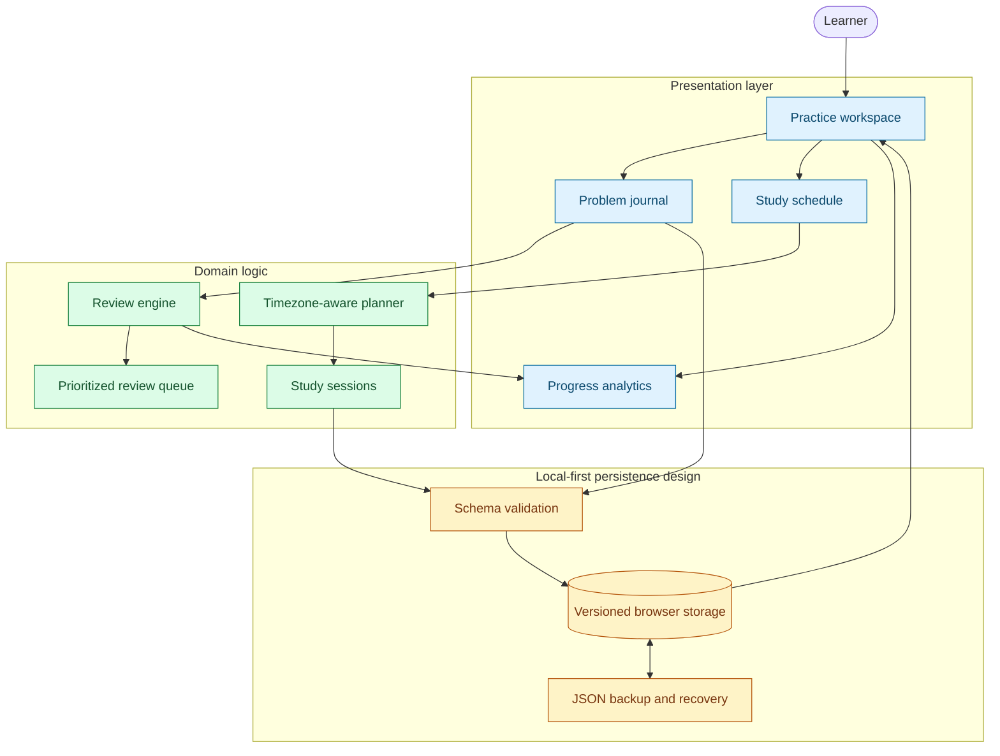
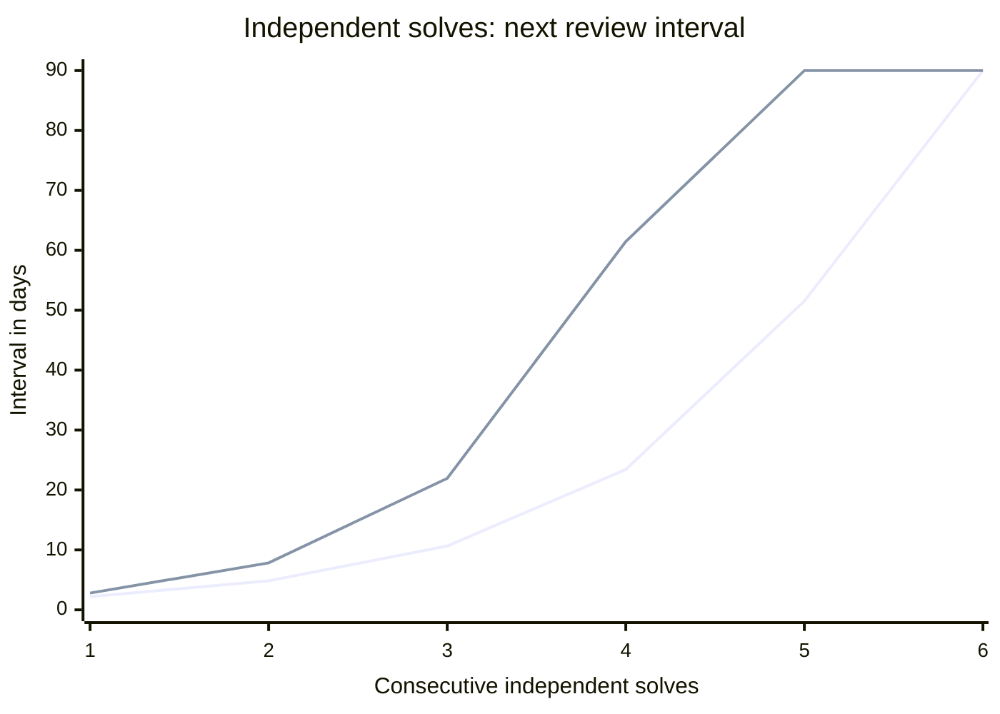
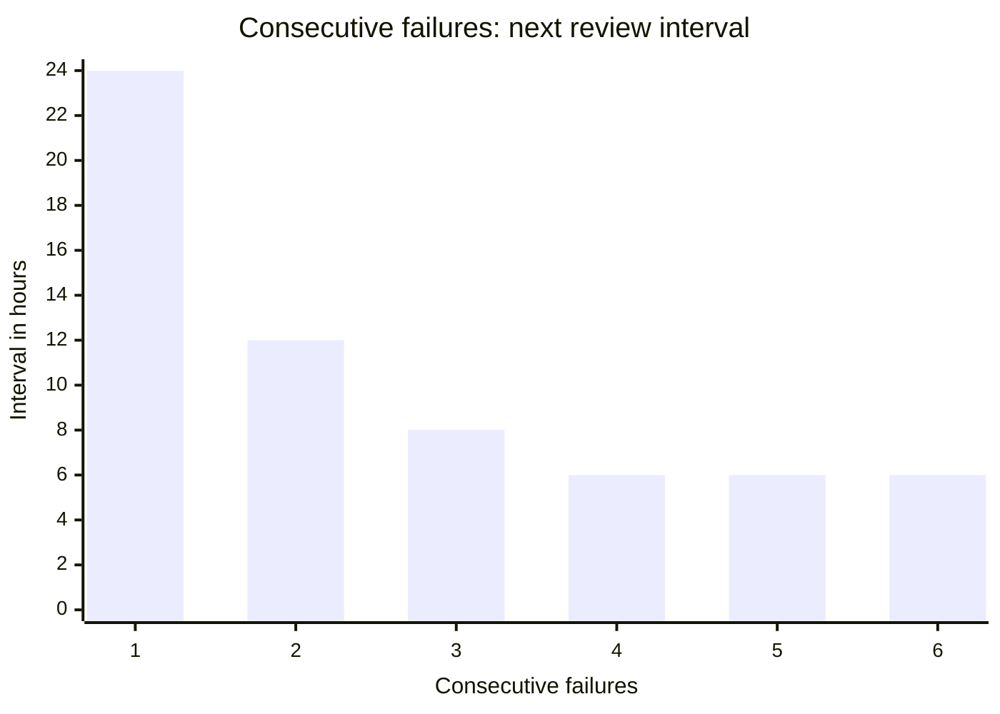
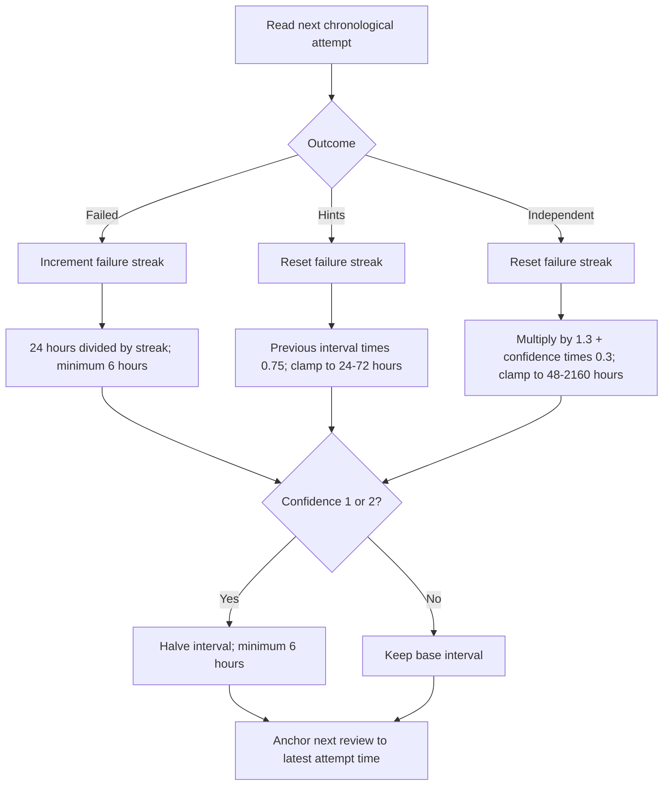
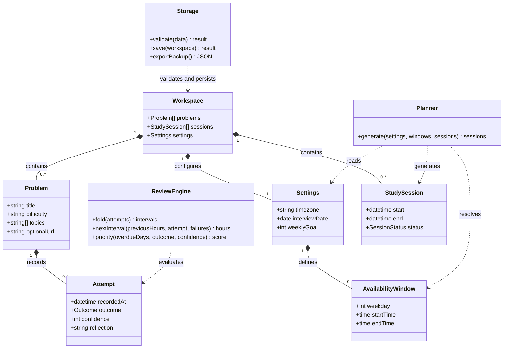
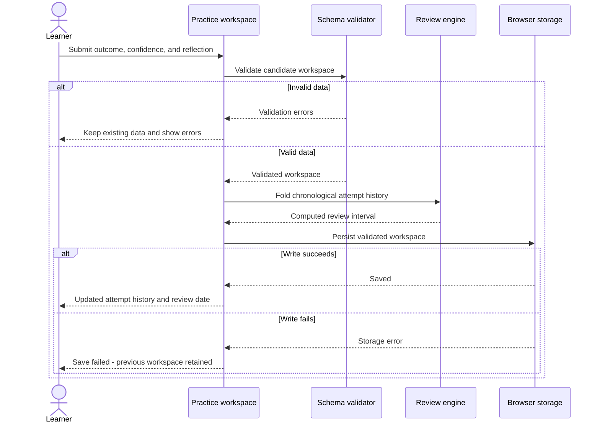
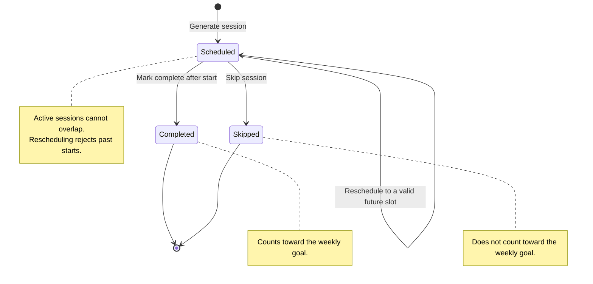
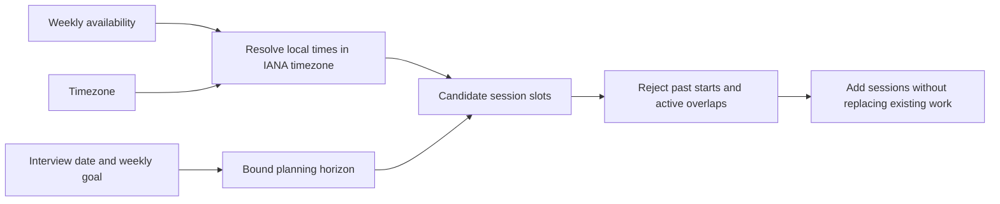

# Ryluno

### Technical interview practice, modeled as an explainable scheduling system.

Ryluno's workspace design combines a problem journal, confidence-aware spaced repetition, and availability-based study planning. The companion visualization implementation turns those scheduling rules into inspectable graphs rather than hiding them behind a black box.

> **Implementation scope:** The original workspace specification describes a local-first Next.js application. This repository contains the TanStack Start visualization companion and a tested review-engine implementation. The workspace architecture diagrams below describe the original design; they do not claim that every workspace feature is implemented here.

## Overview

| Area | Approach |
| :--- | :--- |
| Review scheduling | Deterministic interval updates based on outcome and confidence |
| Explainability | Each interval follows an explicit, inspectable rule |
| Visualization | Computed curves, scheduling comparisons, and interactive figures |
| Workspace design | Local-first problem journal and availability-based planner |
| Current implementation | TanStack Start, React 19, TypeScript, Tailwind CSS v4, Recharts |
| Algorithm tests | Vitest |

## System architecture

The workspace design separates scheduling, planning, and persistence from presentation.



## Review interval growth

Independent solves grow the previous interval by a confidence-dependent multiplier. Stronger confidence produces longer gaps; the 90-day ceiling prevents unbounded growth.

The chart starts from a **1-day interval** and shows six consecutive independent solves. Values are computed from the review engine and rounded for display — not measured learning outcomes.



**Series order:** confidence 3, then confidence 5. Both eventually reach the same ceiling, but confidence 5 reaches it sooner.

### Repeated failure response

Consecutive failures shorten the interval until it reaches the six-hour floor. This chart uses confidence 3, so the additional low-confidence adjustment does not apply.



## Scheduling algorithm

Attempts are processed chronologically. Each attempt updates the interval produced by the previous one.

| Outcome | Base interval rule |
| :--- | :--- |
| Failed | `max(6 hours, 24 hours / consecutive failures)` |
| Solved with hints | `clamp(previous interval × 0.75, 24 hours, 72 hours)` |
| Solved independently | `clamp(previous interval × (1.3 + confidence × 0.3), 48 hours, 2160 hours)` |

After the base rule, confidence **1–2** halves the interval, with a **six-hour minimum**. Consequently, the independent-solve two-day floor applies *before* the low-confidence adjustment.



### Core implementation

Intervals are represented in elapsed hours, independently of the user's timezone.

```typescript
type Outcome = "failed" | "hints" | "independent";

interface Attempt {
  outcome: Outcome;
  confidence: number;
}

export function nextInterval(
  previousHours: number,
  attempt: Attempt,
  consecutiveFailures: number,
): number {
  let hours: number;

  if (attempt.outcome === "failed") {
    hours = Math.max(6, 24 / Math.max(1, consecutiveFailures));
  } else if (attempt.outcome === "hints") {
    hours = Math.min(72, Math.max(24, previousHours * 0.75));
  } else {
    const multiplier = 1.3 + attempt.confidence * 0.3;
    hours = Math.min(2160, Math.max(48, previousHours * multiplier));
  }

  if (attempt.confidence <= 2) {
    hours = Math.max(6, hours / 2);
  }

  return hours;
}
```

The companion implementation lives in `src/lib/algo/review.ts`.

## UML: workspace domain model

This conceptual model describes the original workspace design, not an exact declaration of the companion repository's TypeScript types.



## UML: recording an attempt

The workspace persistence design validates and saves a mutation before presenting it as successful. A failed write must not appear as a saved attempt.




## UML: study-session lifecycle

The workspace design distinguishes scheduled, completed, and skipped sessions. Completion becomes available once a session starts.



## Availability-based planning

The original planner specification uses local wall-clock availability while preserving existing session instants when the timezone changes.



### Planner constraints

- Generate up to **28 days**, ending at the interview date.
- Use **Monday-based weeks** in the configured timezone.
- Reject nonexistent spring-forward local times.
- Resolve ambiguous fall-back local times deterministically.
- Never start a new session in the past or overlap active sessions.
- Count scheduled and completed sessions toward weekly goals; exclude skipped sessions.
- Add at most one new session per availability window per date in a generation pass.
- Permit manual rescheduling outside availability and weekly-goal limits, while retaining past-time and overlap checks.

## Explainable analytics

### Review priority

The companion engine computes:

```text
priority = max(0, overdueDays)
         + outcomePenalty
         + (5 - confidence) × 0.5

outcomePenalty:
  failed       = 2
  hints        = 1
  independent  = 0
```

Higher values indicate greater review urgency.

### Topic mastery design

The original workspace specification defines topic mastery as the average of each problem's latest outcome score, weighted by confidence:

```text
problemContribution = outcomeScore × confidence / 5

outcomeScore:
  independent = 1.0
  hints       = 0.5
  failed      = 0.0
```

This is a transparent learning signal, **not a validated proficiency assessment**.

### Visualization companion

The companion explores the scheduling model through:

- Log-scale interval-growth curves.
- An interactive recall illustration.
- A scheduling transfer function.
- A review-priority bubble chart.
- A topic-mastery radar.
- A daylight-saving-time gap illustration.
- An availability heatmap.
- A contribution-style streak grid.

Illustrative figures are not evidence of a user's actual progress or empirically validated memory predictions.

## Built with

| Technology | Role in this repository |
| :--- | :--- |
| TanStack Start | Application framework |
| TanStack Router | File-based routing |
| React 19 | Interface and interactive figures |
| TypeScript | Typed data and scheduling logic |
| Tailwind CSS v4 | Styling and design tokens |
| Recharts | Data visualizations |
| Vitest | Automated tests |
| Vite | Development and production tooling |

The original workspace document names **Next.js App Router**. That is a separate stack description; this companion repository uses **TanStack Start**.

## Run locally

```sh
npm install
npm run dev
```

Open the local address printed by the development server.

```sh
# Run automated tests
npm test

# Check lint rules
npm run lint

# Produce a production build
npm run build
```

## Implementation map

```text
src/
├── routes/
│   ├── __root.tsx        # Shared application shell
│   └── index.tsx         # Visualization page
├── lib/
│   └── algo/
│       ├── review.ts     # Interval, priority, and outcome calculations
│       └── review.test.ts
├── components/
│   └── ui/               # Shared interface primitives
└── styles.css            # Global styling and theme tokens
```

## Engineering principles

Fo website integration setup and its current limitations are documented in [Fo integration](docs/fo-integration.md). The OAuth foundation is development-only; text submission remains blocked until authenticated Fo tool schemas are verified.

- **Explainable over opaque:** scheduling decisions follow explicit rules.
- **Bounded behavior:** interval floors and ceilings constrain the model.
- **Separation of concerns:** calculations remain independent of chart rendering.
- **Honest presentation:** illustrative data is distinguished from recorded progress.
- **Local-first workspace design:** browser persistence, explicit backups, and no required account.
- **Timezone-aware planning:** wall-clock availability and elapsed review intervals are treated as different concepts.

---

**Ryluno — deliberate practice with decisions you can inspect.**
